# AlgoReplay 실행 가이드

설치부터 첫 복습, 결과 읽는 법, 약점 기반 추천까지 실제 화면으로 따라가는 가이드입니다.

> 이 문서의 화면은 저장소에 포함된 **예제 데이터(Example data)**로 실제로 실행해 캡처했습니다. 예제 문제는 직접 작성한 문제이며, 실제 백준·프로그래머스 문제가 아닙니다. 본인 저장소를 연결해도 화면 구성은 같습니다.

## 목차

1. [준비물](#1-준비물)
2. [설치와 실행](#2-설치와-실행)
3. [문제 저장소 연결하기](#3-문제-저장소-연결하기)
4. [화면 구성](#4-화면-구성)
5. [학습 따라하기 — 한 문제를 다시 풀어 보기](#5-학습-따라하기--한-문제를-다시-풀어-보기)
6. [성장 확인하기 — 과거 풀이와의 비교](#6-성장-확인하기--과거-풀이와의-비교)
7. [피드백은 어떻게 만들어지나](#7-피드백은-어떻게-만들어지나)
8. [약점과 다음 문제 추천](#8-약점과-다음-문제-추천)
9. [추천 학습 루틴](#9-추천-학습-루틴)
10. [LLM 기능 사용하기 (선택)](#10-llm-기능-사용하기-선택)
11. [문제 해결](#11-문제-해결)
12. [데이터 관리](#12-데이터-관리)

---

## 1. 준비물

| 항목 | 필요 여부 | 비고 |
|---|---|---|
| Python 3.11 이상 | 필수 | `python3 --version`으로 확인 |
| Docker | 필수 | 제출 코드는 Docker 안에서만 실행됩니다. [Docker Desktop](https://www.docker.com/products/docker-desktop/)을 설치하고 **실행해 둔 상태**여야 합니다 |
| 문제 저장소 | 선택 | BaekjoonHub로 쌓인 GitHub 저장소 등. 없으면 예제 데이터로 시작 |
| GitHub token | 선택 | private 저장소만 필요 |
| Anthropic API key | 선택 | LLM 리포트·힌트·테스트 입력 생성. 없어도 모든 기본 기능이 동작합니다 |

Docker가 실행 중인지 확인:

```bash
docker info
```

`Server Version`이 보이면 준비된 것입니다. `Cannot connect to the Docker daemon` 오류가 나면 Docker Desktop을 실행하세요.

---

## 2. 설치와 실행

```bash
git clone https://github.com/ahyun39/algoreplay.git
cd algoreplay

python -m venv .venv
source .venv/bin/activate          # Windows: .venv\Scripts\activate
pip install -r requirements.txt

docker pull python:3.11-slim       # 채점용 이미지, 최초 1회
docker pull postgres:16-alpine     # SQL(LeetCode) 문제용, 필요할 때만
```

실행:

```bash
streamlit run app.py
```

브라우저에서 `http://localhost:8501`이 열립니다. 종료는 터미널에서 `Ctrl + C`입니다.

다음부터는 아래 두 줄이면 됩니다.

```bash
source .venv/bin/activate
streamlit run app.py
```

### 설정 파일 (선택)

자주 쓰는 저장소나 API key는 `.env`에 저장해 두면 앱이 자동으로 읽습니다.

```bash
cp .env.example .env
```

```dotenv
GITHUB_OWNER=본인-GitHub-아이디
GITHUB_REPO=CodingTest
ANTHROPIC_API_KEY=          # LLM 기능을 쓸 때만
```

전체 설정 항목은 [README의 설정 항목](../README.md#설정-선택)을 참고하세요.

---

## 3. 문제 저장소 연결하기

저장소 연결은 왼쪽 사이드바의 **문제 저장소 동기화**에서 합니다. 어느 화면에서나 메뉴 바로 아래에 있고, 처음 실행해 문제가 없을 때는 펼쳐진 상태로 나옵니다.

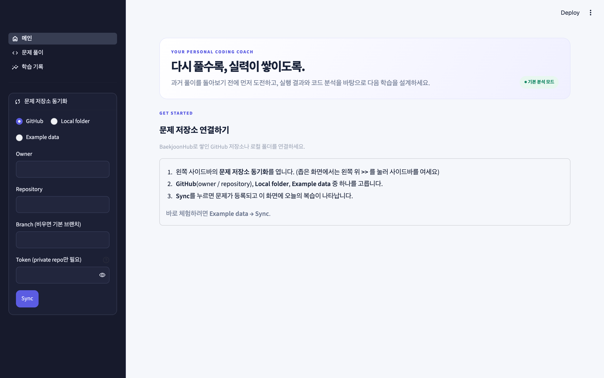

| Source | 입력할 것 | 언제 쓰나 |
|---|---|---|
| **GitHub** | Owner, Repository (Branch는 비워도 됨) | BaekjoonHub로 풀이를 올려 둔 GitHub 저장소 |
| **Local folder** | 저장소를 clone 해 둔 폴더 경로 (예: `~/CodingTest`) | 오프라인이거나 GitHub에 올리지 않은 풀이 |
| **Example data** | 없음 | 설치 확인, 기능 체험 |

**Sync**를 누르면 저장소의 문제를 가져옵니다. 결과는 버튼 아래에 `추가 · 갱신 · 변경 없음 · 삭제` 개수로 표시되고, 건너뛴 폴더가 있으면 **건너뛴 폴더 N개**를 눌러 이유를 볼 수 있습니다 (예: Java 풀이 폴더, LeetCode 형식이 아닌 SQL 폴더).

- 약 400문제 저장소 기준으로 처음 동기화는 15초 정도, 이후에는 바뀐 문제만 가져오므로 1초 이내입니다.
- 저장소에 새 풀이를 올렸다면 사이드바의 **문제 저장소 동기화**를 펼쳐 다시 **Sync**를 누르면 됩니다.
- public 저장소는 token이 필요 없습니다. private 저장소는 Token 칸에 입력하거나 `.env`의 `GITHUB_TOKEN`을 사용하세요 (fine-grained token, Contents: Read-only 권한이면 충분합니다).

인식하는 폴더 구조는 [README의 지원하는 저장소 형식](../README.md#지원하는-저장소-형식)에 정리되어 있습니다.

---

## 4. 화면 구성

앱은 세 화면으로 나뉘어 있고, 왼쪽 사이드바 메뉴에서 오갑니다. 사이드바에는 어느 화면에서나 **문제 저장소 동기화**가 메뉴 바로 아래에 있습니다.

| 화면 | 하는 일 |
|---|---|
| **메인** | 오늘의 상태를 한눈에 보고, 무엇을 복습할지 정하고, 저장소를 동기화 |
| **문제 풀이** | 문제를 고르고, 코드를 작성해 채점하고, 분석 결과를 확인 |
| **학습 기록** | 학습 잔디, 약점 점수, 전체 풀이 기록으로 흐름을 돌아봄 |

### 메인

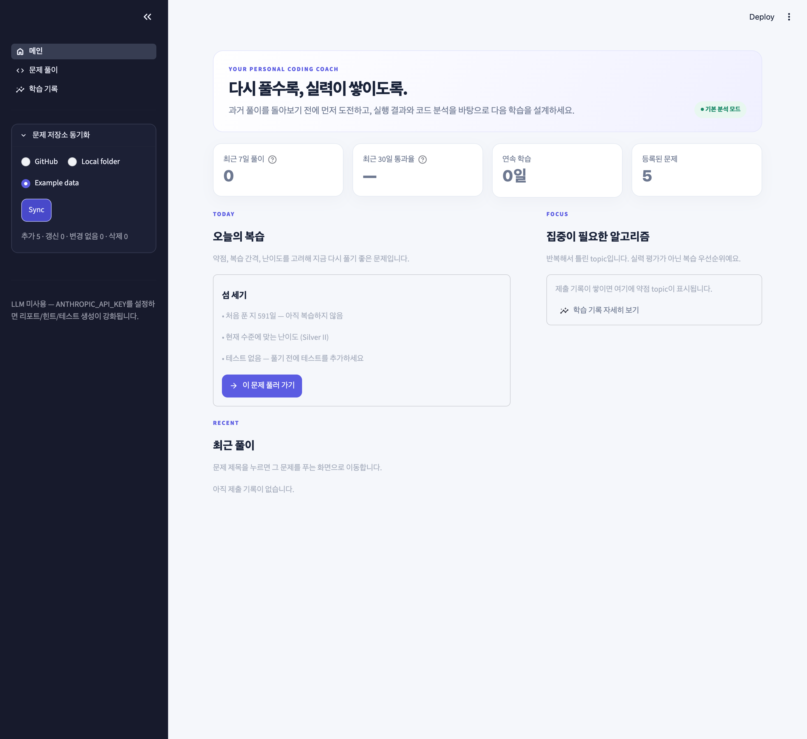

| 위치 | 내용 |
|---|---|
| 상단 배너 | 현재 모드 — `기본 분석 모드`(API key 없음) 또는 `AI 코치 연결`(API key 있음) |
| 요약 카드 | 최근 7일 풀이 수, 최근 30일 통과율, 연속 학습 일수, 등록된 문제 수 |
| **오늘의 복습** | 지금 다시 풀기 좋은 문제와 추천 이유. **이 문제 풀러 가기**를 누르면 문제 풀이 화면에서 그 문제가 열림 |
| **집중이 필요한 알고리즘** | 약점 점수가 높은 topic 최대 3개 |
| **최근 풀이** | 최근 제출 5개. 문제 제목을 누르면 그 문제로 이동 |

### 문제 풀이

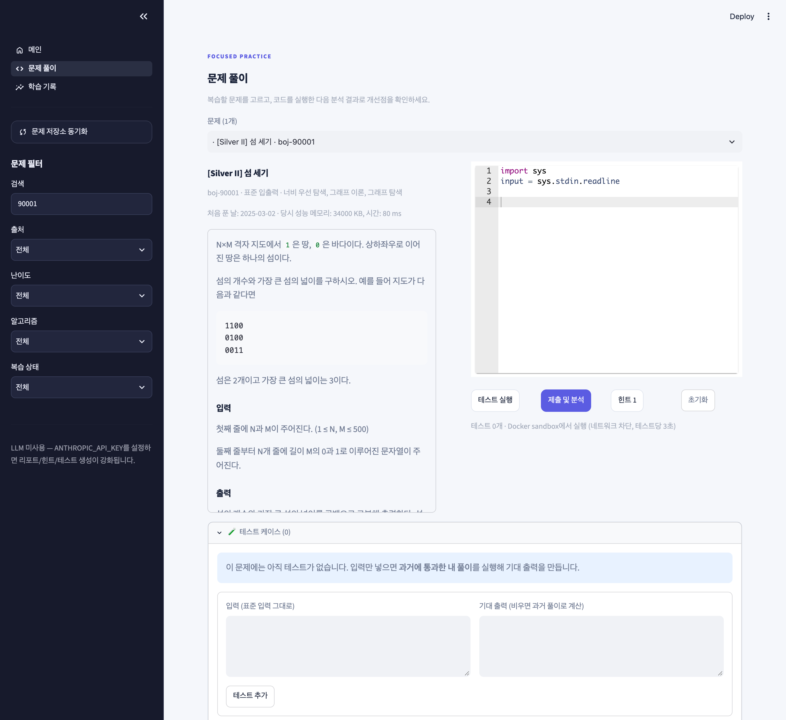

| 위치 | 내용 |
|---|---|
| 사이드바 **문제 필터** | 제목·번호 검색, 출처(백준/프로그래머스), 난이도, 알고리즘, 복습 상태(아직 복습 안 함 / 최근 통과 / 최근 실패) |
| **문제** 선택 상자 | 필터에 맞는 문제 목록. 앞의 아이콘은 마지막 결과 (✅ 통과, ❌ 실패, · 아직 안 풂). 처음 열면 오늘의 복습 문제가 선택됨 |
| 왼쪽 | 문제 번호·채점 방식·분류, **처음 푼 날과 당시 성능**, 문제 설명 |
| 오른쪽 | 코드 편집기와 **테스트 실행 / 제출 및 분석 / 힌트 / 초기화** 버튼 |
| 아래 | 테스트 케이스, 채점 결과와 분석, **제출 결과** |

다른 화면에 다녀와도 필터와 작성 중이던 코드는 그대로 남아 있습니다. 필터를 바꾸면 목록이 다시 걸러집니다.

> 과거에 쓴 풀이는 이 화면 어디에도 나오지 않습니다. 제출한 뒤에만 볼 수 있습니다.

편집기에는 시작 코드가 들어 있습니다. 백준 문제는 빠른 입력 템플릿(`input = sys.stdin.readline`), 프로그래머스 문제는 과거 풀이와 같은 함수 시그니처(`def solution(...)`)입니다.

### 코드 편집기

오른쪽 편집기는 VS Code와 비슷하게 동작하는 코드 편집기입니다. 들여쓰기를 직접 맞추지 않아도 됩니다.

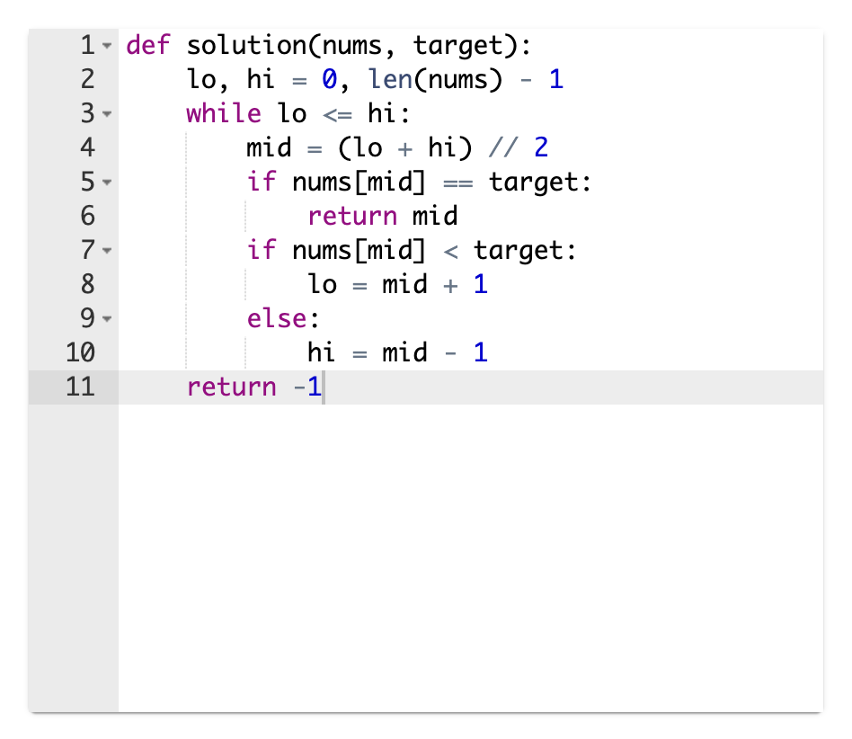

| 동작 | 결과 |
|---|---|
| `:`로 끝나는 줄에서 **Enter** | 다음 줄이 자동으로 4칸 들여쓰기 |
| 그냥 **Enter** | 현재 줄의 들여쓰기 유지 |
| **Tab** / **Shift + Tab** | 들여쓰기 / 내어쓰기 (여러 줄을 선택한 상태에서도 동작) |
| `(` `[` `{` `"` 입력 | 짝이 되는 괄호·따옴표 자동 입력 |
| **Cmd/Ctrl + /** | 선택한 줄 주석 처리 / 해제 |
| **Cmd/Ctrl + Z** | 되돌리기 |

- 입력하는 동안 단어 자동완성 목록이 뜰 수 있습니다. 목록이 열려 있을 때 **Enter**를 누르면 선택된 항목이 입력되니, 줄을 바꾸려면 먼저 **Esc**로 목록을 닫으세요 (VS Code와 같은 동작입니다).
- 다른 문제로 이동했다가 돌아와도 **작성 중이던 코드가 그대로 남아 있습니다.** 단, 브라우저를 새로고침하거나 앱을 다시 시작하면 제출하지 않은 초안은 사라지니, 보관하려면 **제출 및 분석**을 눌러 두세요. 제출한 코드는 언제든 [내가 제출한 코드 보기](#내가-제출한-코드-다시-보기)에서 볼 수 있습니다.
- **초기화** 버튼을 누르면 편집기가 그 문제의 시작 코드로 돌아갑니다.
- 작성한 코드는 입력을 멈추고 잠시 뒤 자동으로 반영되므로, 별도로 저장하거나 적용할 필요 없이 바로 **테스트 실행**이나 **제출 및 분석**을 누르면 됩니다.

---

## 5. 학습 따라하기 — 한 문제를 다시 풀어 보기

예제의 **섬 세기**(백준 형식, 표준 입출력) 문제로 한 번의 복습을 처음부터 끝까지 따라가 봅니다.

### Step 1. 테스트 준비하기

BaekjoonHub의 백준 README에는 예제 입출력이 들어 있지 않아서, 처음에는 테스트가 0개입니다. 화면 아래 **🧪 테스트 케이스**를 열고 입력만 넣은 뒤 **테스트 추가**를 누르세요.

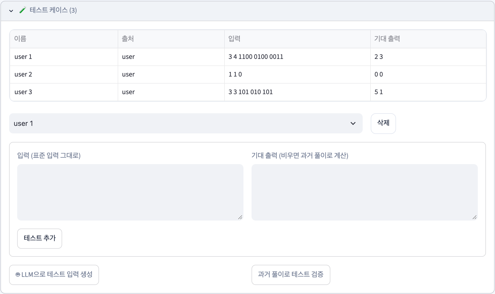

**기대 출력 칸을 비워 두면, 예전에 통과했던 내 풀이를 Sandbox에서 실행해 그 출력을 기대 출력으로 저장합니다.** 위 화면의 `2 3`, `0 0`, `5 1`은 모두 과거 풀이가 계산한 값입니다.

좋은 테스트를 만드는 방법:

1. **원문 예제** — 문제 원문(백준 사이트)의 예제 입력을 그대로 붙여 넣습니다.
2. **경계 값** — 가장 작은 입력(`1 1` / `0`), 모두 같은 값, 가장 큰 값 근처.
3. **헷갈리기 쉬운 경우** — 이 문제라면 대각선으로만 이어진 땅(`101 / 010 / 101`).

기대 출력을 직접 알고 있다면 오른쪽 칸에 적어도 됩니다. 만든 테스트는 다시 동기화해도 사라지지 않고, 필요 없으면 표 아래에서 골라 **삭제**할 수 있습니다.

> **과거 풀이로 테스트 검증** 버튼은 저장소의 과거 풀이가 지금 테스트를 모두 통과하는지 확인합니다. 저장소에 미완성 풀이가 올라가 있는 경우를 찾아낼 때 유용합니다.

프로그래머스 문제는 README의 `입출력 예` 표가 자동으로 테스트가 되므로 이 단계를 건너뛰어도 됩니다.

### Step 2. 스스로 풀어 보기, 막히면 힌트

먼저 과거 풀이를 떠올리지 말고 문제만 보고 풀어 봅니다. 막히면 **힌트 1**부터 한 단계씩 엽니다.

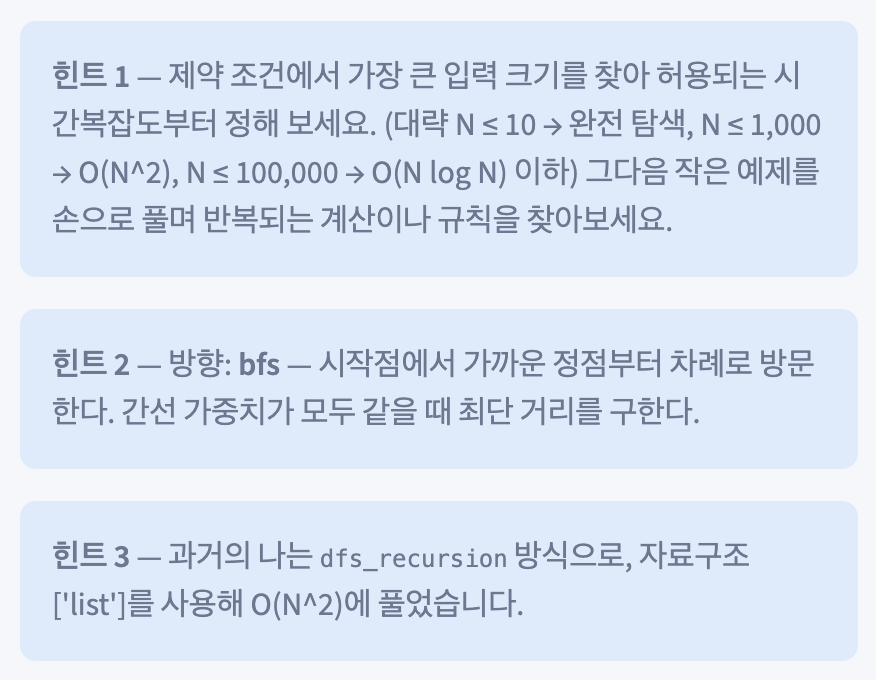

| 단계 | 내용 | 예 (위 화면) |
|---|---|---|
| 힌트 1 | 핵심 관찰 — 알고리즘 이름은 말하지 않음 | 입력 크기로 허용 복잡도 정하기, 작은 예제 손으로 풀기 |
| 힌트 2 | 방향 — 알고리즘·자료구조와 그 핵심 개념 | `bfs` — 가까운 정점부터 차례로 방문 |
| 힌트 3 | 풀이 전략 — **과거의 내가 썼던 접근** | 과거에는 `dfs_recursion` 방식으로 O(N^2)에 풀었음 |
| 힌트 4 | 과거 풀이의 함수 구성과 반복 구조 | — |

힌트는 완성 코드를 보여주지 않습니다. 힌트 3은 "예전의 나"를 떠올리게 하는 단계라서, 기억을 되살리는 데 특히 도움이 됩니다.

### Step 3. 테스트 실행 vs 제출 및 분석

| 버튼 | 하는 일 | 기록 |
|---|---|---|
| **테스트 실행** | Sandbox에서 채점만 합니다 | 저장 안 함 |
| **제출 및 분석** | 채점 + 코드 분석 + 과거 풀이 비교 + 이론 + 다음 추천 | 학습 기록에 저장 |

풀이 중간에는 **테스트 실행**으로 자유롭게 확인하고, 다 됐다고 생각할 때 **제출 및 분석**을 누르세요. 약점 점수는 제출 기록으로만 계산됩니다.

### Step 4. 틀렸을 때 결과 읽기

아래는 상하좌우만 이웃으로 봐야 하는데 **대각선까지 이웃으로 처리한** 풀이를 제출한 결과입니다.

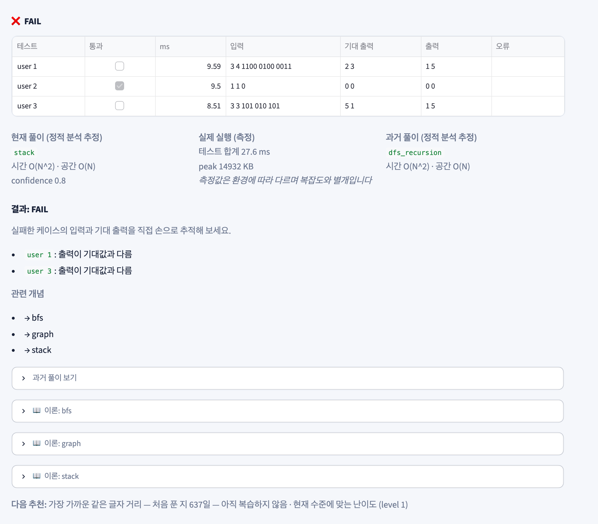

1. **결과 표** — 테스트별 통과 여부, 실행 시간, 입력, 기대 출력, 내 출력, 오류. `user 1`에서 기대값 `2 3`과 달리 `1 5`가 나왔습니다. 섬 두 개가 하나로 합쳐졌다는 뜻이니 이웃 판정을 의심할 수 있습니다.
2. **세 칸 요약** — 현재 풀이와 과거 풀이의 **정적 분석 추정치**(알고리즘, 시간·공간복잡도)와 **실제 측정값**(실행 시간, 메모리)을 따로 보여줍니다.
3. **리포트** — 테스트를 통과하지 못한 풀이는 효율성을 칭찬하지 않고 실패한 케이스부터 짚어 줍니다.
4. **관련 개념** — 펼치면 이론 문서를 바로 읽을 수 있습니다.

> 채점 상태: `PASS` 모두 통과 · `FAIL` 출력이 다름 · `TIMEOUT` 시간 초과(무한 루프나 복잡도 확인) · `RUNTIME_ERROR` 실행 중 예외(오류 메시지 확인) · `SYNTAX_ERROR` 문법 오류

### Step 5. 고친 뒤 다시 제출

이웃 판정을 상하좌우로 고치고 BFS로 다시 제출한 결과입니다.

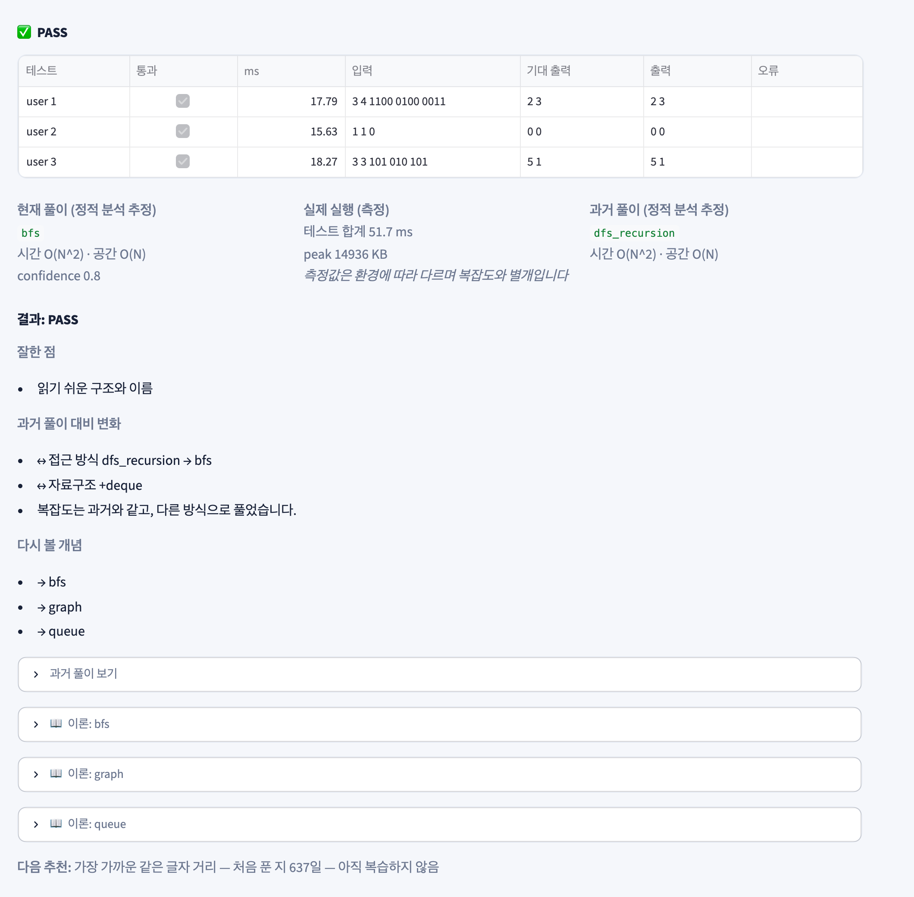

- **과거 풀이 대비 변화** — 과거에는 재귀 DFS(`dfs_recursion`)였고 이번에는 `bfs`로 풀었습니다. 복잡도는 같으므로 "복잡도는 과거와 같고, 다른 방식으로 풀었습니다"라고 표시됩니다.
- **↔ 표시**는 "달라졌지만 좋고 나쁨을 판단하지 않는 변화"입니다. 접근 방식이 바뀐 것 자체를 개선으로 치지 않습니다.
- **과거 풀이 보기**를 펼치면 이제서야 예전 코드를 볼 수 있습니다. 두 풀이를 나란히 놓고 무엇이 달라졌는지 직접 비교해 보세요.

### Step 6. 제출 결과 확인

결과 아래의 **제출 결과** 표에는 이 문제의 전체 이력이 쌓입니다.

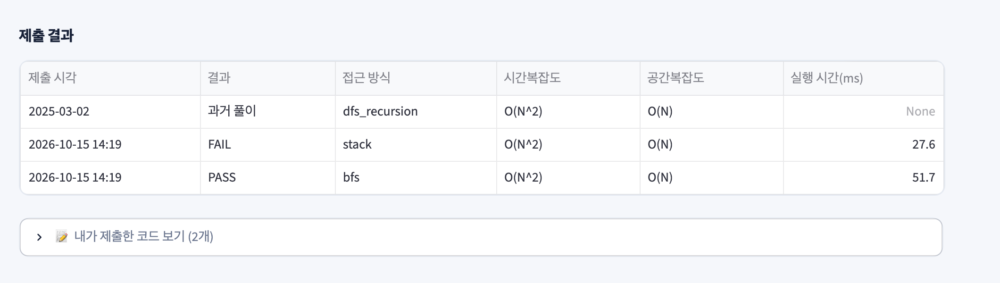

첫 줄은 저장소에 있던 과거 풀이(처음 푼 날 기준), 그 아래는 복습할 때마다 추가되는 시도입니다. 같은 문제를 몇 달 간격으로 다시 풀면 이 표가 **내 풀이 방식이 어떻게 바뀌어 왔는지**를 보여줍니다.

#### 내가 제출한 코드 다시 보기

표 바로 아래의 **📝 내가 제출한 코드 보기**를 펼치면 이 문제에 제출했던 코드를 모두 볼 수 있습니다.

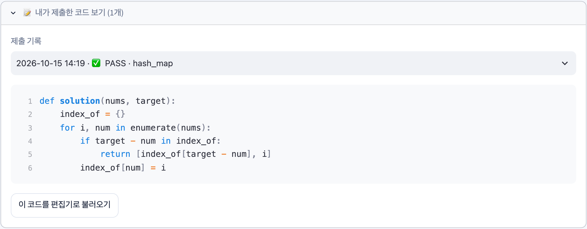

- 위쪽 목록에서 제출을 고르면 (최신순, `제출 시각 · 결과 · 접근 방식`) 그때의 코드가 줄 번호와 함께 표시됩니다.
- **이 코드를 편집기로 불러오기**를 누르면 그 코드가 편집기에 들어가 이어서 고치거나 다시 제출할 수 있습니다.
- 다시 풀 때 예전 답을 실수로 보지 않도록 기본으로 접혀 있습니다. 저장소의 **과거 풀이**(처음 풀었던 코드)는 이 목록에 없고, 제출한 뒤 결과 화면의 **과거 풀이 보기**에서만 볼 수 있습니다.

---

## 6. 성장 확인하기 — 과거 풀이와의 비교

과거에 이중 반복문(brute force)으로 풀었던 **Two Sum**을 이번에는 딕셔너리로 풀어 제출한 결과입니다.

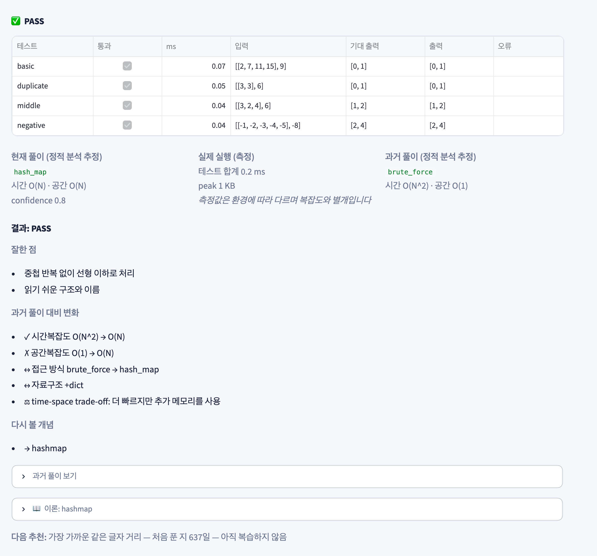

| 표시 | 의미 | 이 예에서 |
|---|---|---|
| ✓ | 개선 | 시간복잡도 O(N^2) → O(N) |
| ✗ | 후퇴 | 공간복잡도 O(1) → O(N) |
| ↔ | 변화 (중립) | 접근 방식 brute_force → hash_map, 자료구조 +dict |
| ⚖ | trade-off | 더 빠르지만 추가 메모리를 사용 |

"더 좋아졌다"로 끝내지 않고 **무엇을 얻고 무엇을 내줬는지**를 보여주는 것이 핵심입니다. 이 경우 공간복잡도가 늘어난 것은 실수가 아니라 의도한 선택이므로, 그 이유를 스스로 설명할 수 있는지 확인해 보세요.

### 복잡도 숫자를 읽는 법

- **정적 분석 추정**은 코드 구조(반복문 중첩, 반복문 안의 선형 연산, 재귀 등)로 계산한 추정치이며 `confidence`가 함께 표시됩니다. 함수가 여러 개로 나뉜 코드나 라이브러리 내부 비용은 틀릴 수 있습니다.
- **실제 측정**은 테스트 입력으로 Sandbox에서 잰 값입니다. 테스트 입력이 작으면 O(N)과 O(N^2)의 차이가 드러나지 않습니다.
- 둘은 서로를 증명하지 않습니다. 복잡도는 추정, 실행 시간은 참고 지표로 보세요.

---

## 7. 피드백은 어떻게 만들어지나

**제출 및 분석**을 누르면 아래 네 단계가 차례로 실행됩니다. API key가 없으면 네 단계 모두 **AI 없이 코드에 들어 있는 규칙만으로** 동작하고, API key가 있으면 마지막 리포트만 LLM이 작성합니다.

```text
① 채점 (실제 실행) → ② 코드 분석 (구조만 읽음) → ③ 과거 풀이와 비교 → ④ 리포트
```

### ① 채점 — Docker 샌드박스 (`algoreplay/sandbox.py`)

작성한 코드를 테스트 케이스마다 실제로 실행하고 출력을 기대 출력과 비교합니다. 결과 상태(PASS / FAIL / TIMEOUT / RUNTIME_ERROR / SYNTAX_ERROR), 테스트별 출력과 오류 메시지, 실행 시간과 메모리가 여기서 나옵니다. **추정이 아니라 측정값**이며, 통과 여부는 오직 이 단계가 결정합니다.

### ② 코드 분석 — 실행하지 않고 구조만 읽음 (`algoreplay/analysis.py`)

Python의 `ast` 모듈로 코드 구조를 읽고 정해진 규칙으로 다음을 추정합니다.

| 항목 | 판단 근거 (예) |
|---|---|
| 알고리즘 종류 | `popleft()` → BFS, `mid`와 `//2` → 이분 탐색, `dp` 변수 → DP, 자기 자신 호출 → 재귀/DFS, 반복문 안의 `dict`·`set` → 해시맵, 이중 반복 → 완전 탐색 |
| 시간복잡도 | 입력 크기에 비례하는 반복문의 중첩 깊이, 반복문 안의 숨은 선형 연산(`replace`, `index`, `sum(arr)` 등), 범위를 절반씩 줄이는 반복, 정렬 |
| 공간복잡도 | `dict`·`set`·`deque` 사용, `[0] * n` 같은 크기가 입력에 비례하는 배열, `append`, 재귀 |
| 클린 코드 (1~5점) | 중첩 깊이 4단계 초과, `i`·`j`·`n` 같은 관용적 이름을 제외한 한 글자 변수, 30줄을 넘는 함수, 3줄을 넘는 중복 |

복잡도는 추정치이므로 신뢰도(`confidence`)가 함께 표시됩니다. 읽는 법은 [복잡도 숫자를 읽는 법](#복잡도-숫자를-읽는-법)을 참고하세요.

### ③ 과거 풀이와 비교 (같은 파일)

저장소에 있던 과거 풀이도 ②와 **같은 기준으로** 분석한 뒤 항목별로 비교합니다. 결과는 ✓ 개선 · ✗ 후퇴 · ↔ 변화 · ⚖ 트레이드오프로 표시됩니다 (의미는 [6장](#6-성장-확인하기--과거-풀이와의-비교) 참고).

### ④ 리포트 (`algoreplay/coach.py`)

①~③의 결과를 **잘한 점 → 과거 대비 변화 → 개선점 → 관련 이론** 순서로 정리합니다. 관련 이론은 문제 분류와 탐지된 알고리즘으로 내장 이론 문서 중 최대 3개를 골라 연결합니다.

- **틀렸을 때**는 효율성을 칭찬하지 않고, 어느 테스트가 왜 실패했는지(출력이 다름, 시간 초과, 오류 메시지)와 상태별 조언을 먼저 보여줍니다. 결과 화면 읽는 법은 [Step 4](#step-4-틀렸을-때-결과-읽기)에 있습니다.
- 제출 기록은 DB에 저장되어 약점 점수, 학습 잔디, 다음 문제 추천에 반영됩니다.

### API key가 없을 때와 있을 때

| | API key 없음 (기본) | API key 있음 |
|---|---|---|
| ① 채점 · ② 분석 · ③ 비교 | 규칙 기반 | **똑같음** (LLM이 바꾸지 않음) |
| ④ 리포트 | 정해진 틀에 결과를 채운 요약 | Claude가 현재·과거 코드, 실패한 테스트, 분석 결과를 함께 보고 문장으로 설명 |
| 힌트 | 분류 → 이론 → 과거 접근 → 함수 구성 | 작성 중인 코드를 보고 단계에 맞춘 힌트 |

설정 방법은 [LLM 기능 사용하기](#10-llm-기능-사용하기-선택)를 참고하세요. 어느 경우에도 정답 코드는 알려주지 않습니다.

### 규칙 기반 피드백의 한계

- **왜 틀렸는지는 짚어 주지 못합니다.** 어떤 테스트가 실패했는지는 보여주지만 버그가 있는 줄을 찾아 주지는 않습니다. 실패한 입력을 손으로 따라가 보거나, 힌트를 활용하세요.
- **코드의 의미까지 검토하지는 않습니다.** 변수 이름, 가독성, 예외 케이스 처리는 단순한 규칙으로만 확인합니다.
- **복잡도가 틀릴 수 있습니다.** 코드가 여러 함수로 나뉘어 있거나 라이브러리 내부 동작에 의존하면 부정확할 수 있습니다.

---

## 8. 약점과 다음 문제 추천

제출이 쌓이면 **학습 기록** 화면에서 전체 흐름을 볼 수 있습니다. 아래는 Binary Search 문제를 같은 경계 조건 실수(`while lo < hi`로 마지막 칸을 확인하지 않음)로 두 번 틀린 뒤의 화면입니다.

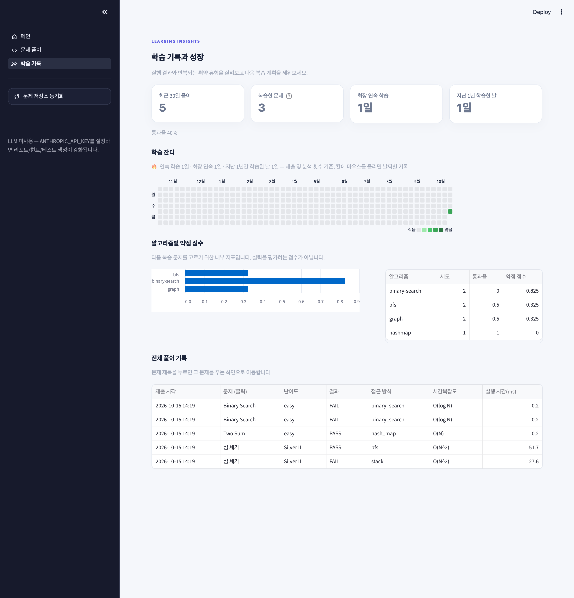

- **요약 카드** — 최근 30일 풀이 수와 통과율, 복습한 문제 수, 최장 연속 학습, 지난 1년 동안 학습한 날
- **학습 잔디** — 날짜별 풀이 기록과 연속 학습 일수 ([아래](#학습-잔디--매일의-기록)에서 자세히)
- **알고리즘별 약점 점수** — `binary-search`가 0.825로 가장 높습니다. 두 번 모두 실패했고, 같은 topic의 실패가 반복되어 `repeated_mistake`로도 기록됐기 때문입니다.
- **최근 풀이** — 언제, 어떤 문제를, 어떤 방식으로 풀었는지. **문제 제목을 누르면** 문제 풀이 화면으로 넘어가 그 문제를 바로 다시 풀 수 있습니다.

```text
weakness = 실패율 × 0.45 + 반복 실수 비율 × 0.35 + 최근 3회 실패율 × 0.20
```

약점은 문제의 **알고리즘 분류 단위**(`bfs`, `binary-search` 등)로 계산합니다. 실력 평가가 아니라 다음에 무엇을 복습할지 고르기 위한 내부 지표입니다.

### 학습 잔디 — 매일의 기록

**학습 기록** 화면의 **학습 잔디**는 GitHub 홈의 잔디처럼, 지난 1년 동안 하루하루 얼마나 복습했는지를 한눈에 보여줍니다.

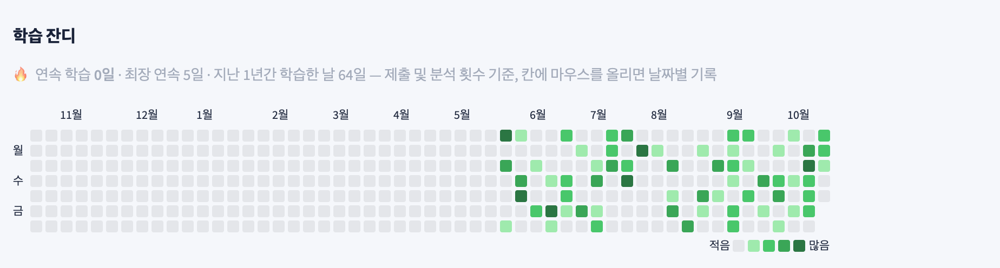

> 위 화면은 기능을 보여주기 위해 몇 달치 **예시 기록**을 넣어 캡처한 것입니다. 처음 사용할 때는 오늘 칸만 채워집니다.

- **한 칸 = 하루, 한 열 = 일주일**(일요일 → 토요일)입니다. 오른쪽 끝 열이 이번 주입니다.
- 색이 진할수록 그날 많이 풀었다는 뜻입니다: 0회 · 1회 · 2–3회 · 4–5회 · 6회 이상.
- 칸에 마우스를 올리면 `2026-10-12 · 4회 풀이 · 통과 3`처럼 그날의 기록이 보입니다.
- **🔥 연속 학습**은 오늘까지(오늘 아직 안 풀었다면 어제까지) 하루도 빠짐없이 푼 날 수입니다. 오늘 아직 풀지 않았다고 연속 기록이 바로 끊기지는 않으며, 하루를 통째로 건너뛰면 0으로 돌아갑니다.
- **최장 연속**과 **지난 1년간 학습한 날**도 함께 표시됩니다.

집계 기준은 **제출 및 분석**으로 채점된 제출입니다. **테스트 실행**은 기록되지 않으므로 잔디에도 반영되지 않습니다. Docker가 꺼져 있어 채점되지 않은 제출도 세지 않습니다. 날짜는 사용 중인 컴퓨터의 시간대를 기준으로 나눕니다.

### 추천은 어떻게 정해지나

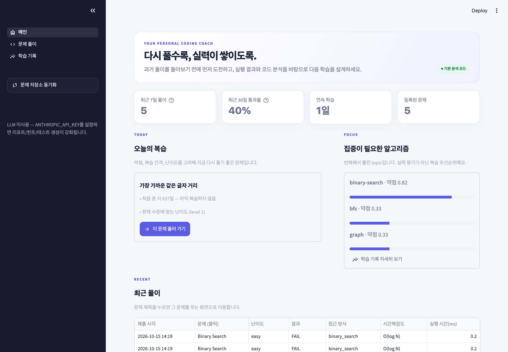

| 요소 | 가중치 | 의미 |
|---|---|---|
| Weakness Match | 40% | 문제 분류가 현재 약점과 겹치는가 |
| Spaced Review | 25% | 마지막 복습(또는 처음 푼 날) 이후 오래 지났는가 |
| Difficulty Fit | 20% | 최근 통과율로 정한 목표 난이도와 맞는가 (통과율 50% 미만이면 쉬운 문제부터) |
| Novelty | 15% | 최근 3번 안에 푼 문제가 아닌가 |

위 화면에서 약점이 가장 큰 Binary Search가 아니라 **아직 복습하지 않은 다른 문제**가 추천된 이유는, Binary Search를 방금 풀었기 때문입니다 (Spaced Review와 Novelty 점수가 0). 같은 문제를 바로 반복하기보다 시간을 두고 다시 보게 하고, 시간이 지나면 약점 가중치 때문에 Binary Search가 다시 추천 상위로 올라옵니다. 같은 분류의 **다른 문제**가 저장소에 있다면 약점 가중치를 받으면서도 최근에 풀지 않은 문제라서 추천 상위에 오르기 쉽습니다.

약점 topic을 바로 집중해서 연습하고 싶다면 **문제 풀이** 화면 사이드바의 **알고리즘** 필터에서 해당 topic을 고르고, **복습 상태**를 "아직 복습 안 함"으로 두세요.

---

## 9. 추천 학습 루틴

### 매일 (20~40분)

1. 앱을 열고 **메인**의 **오늘의 복습**에서 **이 문제 풀러 가기**를 누릅니다.
2. 테스트가 없으면 원문 예제와 경계 값으로 2~3개를 추가합니다.
3. 과거 풀이를 떠올리지 말고 풉니다. 10분 이상 막히면 힌트를 한 단계씩만 엽니다.
4. **제출 및 분석** 후 비교 결과를 읽고, **과거 풀이 보기**로 예전 코드와 비교합니다.
5. 관련 이론의 **자주 하는 실수**와 **연습 질문**을 읽고 답해 봅니다.

### 매주

1. 새로 푼 문제를 GitHub에 올렸다면 **Sync**합니다.
2. **학습 기록**에서 학습 잔디로 지난주에 빈 날이 있었는지, 약점 점수가 높은 topic은 무엇인지 확인합니다.
3. **문제 풀이** 화면 사이드바에서 그 topic으로 필터링해 2~3문제를 집중적으로 다시 풉니다.
4. **복습 상태 = 최근 실패** 필터로 실패한 채 남은 문제를 정리합니다.

### 이렇게 쓰면 더 효과적입니다

- 힌트 3(과거의 내 접근)을 보기 전에 **스스로 접근을 말로 설명**해 보세요.
- 통과한 뒤에도 비교 결과에 ✗나 ⚖가 있다면, 그 선택이 의도였는지 짚고 넘어가세요.
- 같은 문제를 몇 주 뒤 다시 풀어 **제출 결과** 표가 길어질수록 성장 기록이 선명해집니다.

---

## 10. LLM 기능 사용하기 (선택)

`.env`에 `ANTHROPIC_API_KEY`를 넣고 앱을 다시 실행하면 사이드바 하단에 `🤖 LLM 사용`이 표시되고 다음이 달라집니다.

| 기능 | LLM 없이 | LLM 사용 시 |
|---|---|---|
| 학습 리포트 | 정해진 형식의 요약 | 채점·분석 결과를 근거로 한 설명 (완성 코드는 주지 않음) |
| 힌트 | 분류 → 이론 → 과거 접근 → 함수 구성 | 문제와 **지금 작성 중인 코드**를 보고 단계에 맞춘 힌트 |
| 테스트 | 직접 입력 | **🤖 LLM으로 테스트 입력 생성** 버튼 활성화 |

LLM은 **입력만** 만들고, 기대 출력은 항상 과거 풀이를 실행해 얻습니다. 과거 풀이가 처리하지 못한 입력(오류, 시간 초과)은 자동으로 제외됩니다. 채점 결과와 복잡도 추정값도 LLM이 정하지 않습니다.

> LLM을 사용하면 문제 설명, 제출 코드, 과거 풀이가 Anthropic API로 전송됩니다. 자세한 내용은 [SECURITY.md](../SECURITY.md)를 참고하세요.

---

## 11. 문제 해결

| 증상 | 원인과 해결 |
|---|---|
| 결과가 🐳 `SANDBOX_UNAVAILABLE` | Docker가 실행 중이 아닙니다. Docker Desktop을 켜고 `docker info`로 확인한 뒤 다시 실행하세요. 제출 코드는 Docker 없이 실행되지 않습니다 |
| 결과가 🧪 `NO_TESTS` | 이 문제에 테스트가 없습니다. [Step 1](#step-1-테스트-준비하기)처럼 테스트를 추가하세요 |
| 처음 실행이 오래 걸림 | `python:3.11-slim` 이미지를 내려받는 중입니다. `docker pull python:3.11-slim`을 미리 실행하세요 |
| SQL 문제에서 🐳 SANDBOX_UNAVAILABLE | SQL 채점용 이미지가 없습니다. `docker pull postgres:16-alpine`을 실행하세요 |
| SQL 과거 풀이가 RUNTIME_ERROR | 과거 풀이가 MySQL 문법(`AS 'rank'`, `DATE_FORMAT`, `IFNULL` 등)입니다. 채점은 PostgreSQL 16이므로 다시 풀 때 PostgreSQL 문법으로 작성하세요 |
| `동기화 실패: ... not found` | Owner/Repository 이름을 확인하세요. private 저장소라면 Token이 필요합니다 |
| `GitHub API rate limit exceeded` | token 없이 짧은 시간에 많이 동기화한 경우입니다. 잠시 후 다시 하거나 `GITHUB_TOKEN`을 설정하세요 |
| 건너뛴 폴더가 많음 | Python 풀이가 없는 폴더(Java, 프로그래머스 SQL 등), LeetCode Python 풀이, BaekjoonHub 문제와 겹치는 노트북, 한 파일에 여러 문제가 있는 노트북은 건너뜁니다. **건너뛴 폴더**에서 이유를 확인하세요 |
| 문제 설명이 없음 | 노트북·txt처럼 코드만 저장된 파일에서 가져온 문제입니다. 화면의 **원문 보기** 링크나 검색어로 원문을 확인하세요 |
| "과거 풀이로 테스트 검증"이 실패 | 저장소의 과거 풀이가 미완성이거나, 직접 적은 기대 출력이 틀렸을 수 있습니다. 결과 표에서 어떤 테스트가 실패하는지 확인하세요 |
| 답이 맞는데 FAIL | 출력 형식(공백, 줄바꿈 순서)을 확인하세요. 줄 끝 공백과 마지막 빈 줄은 무시하지만, 그 외 형식은 정확히 비교합니다. 답이 여러 개인 문제(special judge)는 지원하지 않습니다 |
| 재귀 풀이가 `RUNTIME_ERROR` | `RecursionError`라면 `sys.setrecursionlimit`을 늘리거나 반복문으로 바꾸세요. 메모리 제한(256MB)을 넘으면 `killed`가 표시됩니다 |
| `pre-release AlgoReplay` DB 오류 | 이전 버전이 만든 DB입니다. `algoreplay.db`를 지우고 다시 동기화하세요 |
| 사이드바(메뉴·필터)가 안 보임 | 창이 좁으면 접힙니다. 왼쪽 위 **>>** 를 누르세요 |

---

## 12. 데이터 관리

- 모든 기록은 프로젝트 폴더의 `algoreplay.db`(SQLite) 한 파일에 저장됩니다. 위치는 `DATABASE_PATH`로 바꿀 수 있습니다.
- **백업**: 이 파일을 복사해 두면 됩니다.
- **초기화**: 앱을 끄고 파일을 지운 뒤 다시 동기화합니다. 풀이 기록과 직접 추가한 테스트가 모두 사라지니 주의하세요.
- 저장소에서 문제를 지워도, 복습 기록이 있는 문제는 학습 이력을 지키기 위해 DB에 남겨 둡니다.
- `algoreplay.db`와 `.env`는 `.gitignore`에 포함되어 있어 실수로 커밋되지 않습니다.
